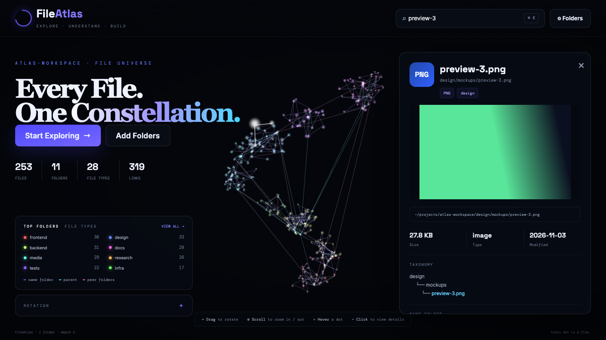

<div align="center">

# FileAtlas

**See a whole folder at once. Your files as a rotating 3D constellation, linked by folder.**

[](#quick-start)

[](LICENSE)
[](src/App.jsx)
[](src/index.css)
[](src/lib/atlas.js)
[](server.js)
[](#privacy-and-security)
[](https://github.com/imdadareeph/file-atlas/commits/main)
[](#license)



</div>

---

## Why

Folder trees show you one level at a time. After a while a project directory becomes a pile you can't hold in your head: which folders are huge, what kinds of files dominate, what sits next to what. FileAtlas was built to answer those questions at a glance. Point it at a folder and the shape of it appears: dense clusters where a lot lives, thin strands where little does, and links that show how the folders relate.

It runs entirely on your machine. Nothing is uploaded anywhere.

## What it does

- **One dot per file.** Dots cluster by top-level folder, with subfolders offset inside each cluster.
- **Folder-aware links.** Three kinds of edges are drawn:
  - *same folder* (files in one folder form a ring)
  - *parent* (a folder links to its nearest ancestor with files)
  - *peer folders* (sibling folders under one parent)
- **File-type detection.** Extensions are grouped into image, video, audio, document, data, code, design, archive and other.
- **Top folders and file types**, bottom left, with a "view all" toggle.
- **Hover** a dot for a preview card (name, path, size, and an image thumbnail). **Click** it for a detail panel: size, type, modified date, path taxonomy, files in the same folder, and *Open File*.
- **Glow.** The hovered or selected dot pulses, its neighbors glow softly, and every link touching it lights up.
- **Zoom** from deep inside the cloud out to "dots only", where the interface fades away.
- **Rotation panel** (collapsed accordion): auto-rotate, speed, yaw, pitch, roll, reset.
- **Search** with <kbd>⌘</kbd>/<kbd>Ctrl</kbd>+<kbd>K</kbd>; <kbd>Enter</kbd> jumps to the first match.
- **Nothing hardcoded.** Every number and label comes from your scan.

## Quick start

```bash
git clone https://github.com/imdadareeph/file-atlas.git
cd file-atlas
./run.sh               # http://127.0.0.1:4757
```

`run.sh` frees port 4757 if something is already using it, installs dependencies on first run, and starts the dev server. Use `./run.sh prod` to build and serve the production bundle. Without the script: `npm install && npm run dev`.

Two entry points are served:

| URL | What |
| --- | --- |
| `/` | The React + Tailwind app |
| `/fileatlas.html` | A standalone single-file version with the same features (also works opened straight from disk, using the folder picker) |

## Adding folders

The app starts blank. Click **Add Folders**.

1. **Choose folder…** (Chrome / Edge): the browser asks your permission for the folder you pick and the scan runs in the page. This works even where macOS blocks Node from reading protected places like your Desktop. Pick several, one at a time. Reloading needs at most one "Re-allow" click.
2. **Advanced · type paths**: absolute paths (`~` works) read by the server. It needs OS-level access to the folders, and it is what makes default folders possible (see below).

**Max depth** (default 3) sets how many subfolder levels below each folder are scanned. Hidden entries and `node_modules` are skipped. Your choices are remembered in the browser.

## Configuration

All optional environment variables:

| Variable | Default | Meaning |
| --- | --- | --- |
| `PORT` | `4757` | Server port |
| `FILEATLAS_PATHS` | *(blank)* | Default folders, separated by `:` |
| `FILEATLAS_DEPTH` | `3` | Default max depth |
| `FILEATLAS_MAX_FILES` | `5000` | Cap on dots; a "limit reached" note appears if hit |

```bash
FILEATLAS_PATHS=~/Documents:~/Projects FILEATLAS_DEPTH=4 ./run.sh
```

## Controls

| Action | Result |
| --- | --- |
| Drag | Rotate |
| Scroll | Zoom in / out (far out hides the UI) |
| Hover | Preview card, glow |
| Click a dot | Detail panel |
| Click empty space, <kbd>Esc</kbd> | Close panel |
| <kbd>⌘</kbd>/<kbd>Ctrl</kbd>+<kbd>K</kbd> | Search |

## How it works

- `src/lib/model.js` groups files by folder, lays the clusters out in 3D and builds the link graph.
- `src/lib/atlas.js` is the three.js engine: a shader-based point cloud with glow, plus line segments for links. React owns the UI state; the engine owns the render loop.
- `src/lib/browserScan.js` walks folders picked through the File System Access API and keeps the handles in IndexedDB.
- `server.js` is the optional Node server. It scans typed paths, streams files for previews, and (in development) hosts Vite. It uses only Node built-ins.

```
src/
  App.jsx  main.jsx  index.css
  components/   Header Hero Summary BottomLeft HoverCard Detail ScanModal Scene
  lib/          model.js atlas.js browserScan.js api.js fmt.js
server.js       folder scanner + file streamer
fileatlas.html  standalone single-file version
run.sh          free the port and start
```

## Privacy and security

- Everything stays local. There is no telemetry. The only outside requests are Google Fonts and, for the standalone page, three.js from a CDN.
- The server listens on `127.0.0.1` only, rejects requests with a foreign `Host` or `Origin`, and serves files only from folders you have scanned.
- Folder-picker mode never sends your files to the server at all.

## Limits

- The folder picker needs a Chromium browser. Other browsers can use typed paths.
- Browsers hide absolute paths for picked folders, so the detail panel shows the path from the picked folder down.
- Chrome refuses to pick top-level system folders (for example your whole Desktop); subfolders are fine.
- Very large trees are capped (default 5,000 files) to keep the animation smooth.

## License

[MIT](LICENSE) © 2026 imdadareeph
